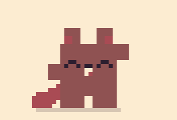
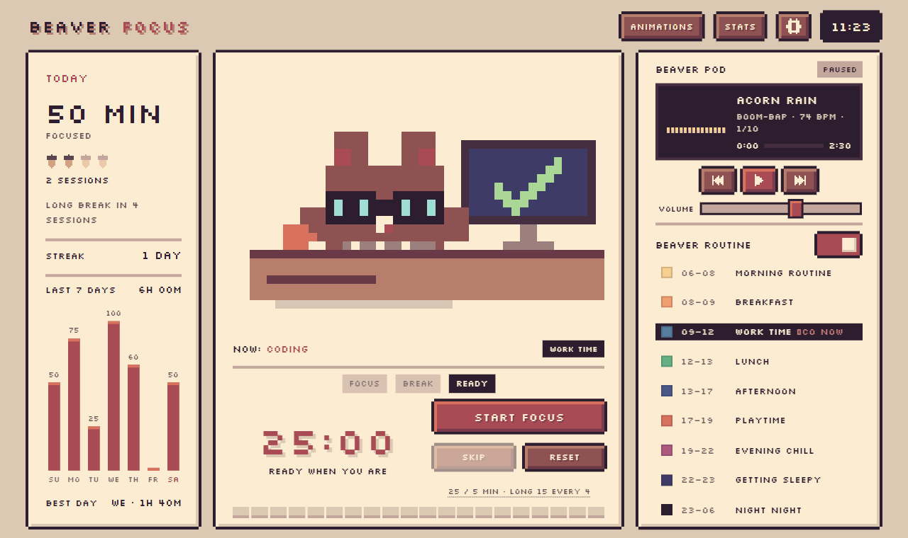
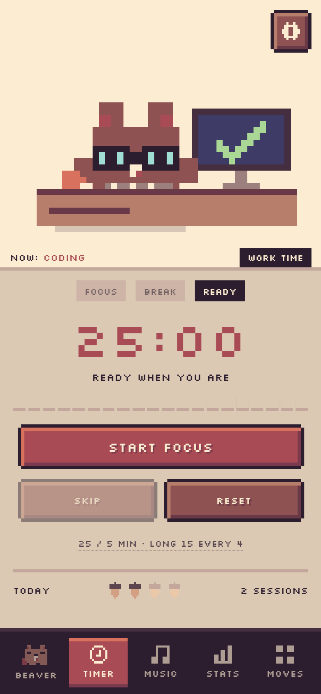
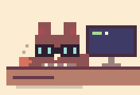
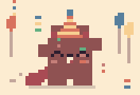
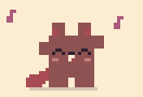
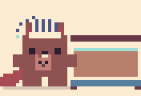
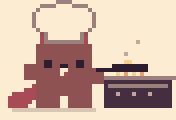
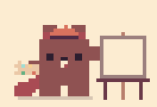
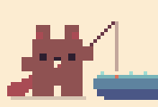

  

<h1 align="center">Beaver Focus</h1>

<b><a href="https://beaver-apps.github.io/focus/">Open Beaver Focus</a></b> · beaver-apps.github.io/focus/

  <b>A tiny pixel beaver who locks in with you.</b> 
  Pomodoro timer · lo-fi music he makes up as you go · a cozy daily routine · stats, streaks and acorns

  
  &nbsp;
  

---

## Hi, I'm the beaver :)

I keep you compnay while you work. Press the big red button and I sit down at my desk and get to work too.
When the session's done I throw a littel party, and on your break I put my feet up. When we're not working,
I just live my day: brekfast, building dams, playtime, a cozy fire, and bed.

## What I do

<table>
  <tr>
    <td align="center"> <b>Lock in</b> I work right beside you</td>
    <td align="center"> <b>Celebrate</b> every session you finish</td>
    <td align="center"> <b>Take breaks</b> dancing counts</td>
    <td align="center"> <b>Night night</b> bedtime is importent</td>
  </tr>
  <tr>
    <td align="center"> <b>Breakfast</b> 8 to 9, evry day</td>
    <td align="center"> <b>Paint</b> work time can be creative</td>
    <td align="center"> <b>Go fishing</b> at playtime</td>
    <td align="center"><b>…and 50 more</b> swimming, snowmen, video calls, a lollipop, a tantrum, Hackerman</td>
  </tr>
</table>

## Everything in the burrow

- **Pomodoro timer.** Focus, short break, long break after every few sessions. You choose all the lengths.
  It keeps counting while the app is closed, and asks nicely if a session ended while you were away.
- **Beaver Pod.** Ten lo-fi tracks made live in your browser, no audio files: boom-bap, tape hiss, chillhop,
  ambient, jazz, 8-bit, bossa, music box, marimba and synthwave. They start when you lock in, and I wear headphones.
- **My routine.** With no timer running I follow your real clock (see my day below).
- **Stats.** Minutes, sessions (as acorns), streaks, your best day and a 14-day chart.
- **Phone, tablet or computer.** It looks right at every size, a phone held sideways too, even a tiny window next to your other apps.
  Install it to your home screen or desktop, and it works offline. Back steps out of whatever is open, like any app.
- **Gentle alerts.** A jingle, a buzz on phones and a notification when a session ends.
- **Light and dark**, plus **calm mode** for gentler motion.
- **Languages.** I speak English, Svenska, Dansk, Norsk, Suomi, Deutsch, Español, Français, 中文 and 日本語.
  I pick yours from your device the first time, and you can switch in Settings. I make typos in all of them :P
- **Sync between devices** through a private GitHub gist, if you want it.
- **Pick any of my moves** (sorted into Moods, Work, Play, Home and Weather), **download it as a GIF**, or open the **Studio** to see every one.
- **Buttons that say what they do**, with a little pixel tip when you rest the mouse on them.
  Who made me is at the bottom of the screen (on phones, at the bottom of Settings).

### Little tricks

| Do this | And I… |
|---|---|
| Click or tap me | slap my tail |
| Press <kbd>Space</kbd> | jump (and start or pause the timer) |
| Shake your phone | jump |
| Skip your breaks too often | get very, very tierd |

## My day

| Time | What I'm up too |
|---|---|
| 06–08 | Morning routine: shower, brush teeth, wash paws |
| 08–09 | Breakfast: cooking, juice, water |
| 09–12 | Work time: coding, video calls, painting |
| 12–13 | Lunch: eating, baking, dishes |
| 13–17 | Afternoon: more work, building the dam, carrying acorns |
| 17–19 | Playtime: kicking a ball, swinging, dancing, fishing (snowmen and snow angels in winter) |
| 19–22 | Evening chill: TV, gaming, the cozy fire, a lollipop |
| 22–23 | Getting sleepy |
| 23–06 | Night night -_- zZz |

## Your data stays with you

Everything is saved in your own browser. Nothing is sent anywhere, unless you turn on sync in Settings.
Then your stats and settings go to a private gist on your own GitHub account, using a token you paste in once.

## Versions

Every update has a name. You can see them all in **Settings → What's new**.
The newest is **v2.9.0 "Thumb Reach"**.

## About this repo

This repo holds the ready-to-use Beaver Focus that runs at https://beaver-apps.github.io/focus/ (just the built files).
The source code is private for now.

## License

Copyright 2026 BwunLevain (https://github.com/BwunLevain). **All rights reserved.**

You're welcome to use the app, install it and share the link, but please don't copy, re-upload, change or sell it,
or reuse the beaver and the art. The details are in [LICENSE.md](LICENSE.md).

The pixel font Silkscreen is by The Silkscreen Project Authors and keeps its own
license, the [SIL Open Font License 1.1](fonts/OFL.txt). The Chinese and Japanese pixel font is
[Fusion Pixel Font](https://github.com/TakWolf/fusion-pixel-font) by TakWolf, also under the SIL Open Font License
(`public/fonts/fusion-pixel/`).

 Now go lock in. I'll be rigth here.

